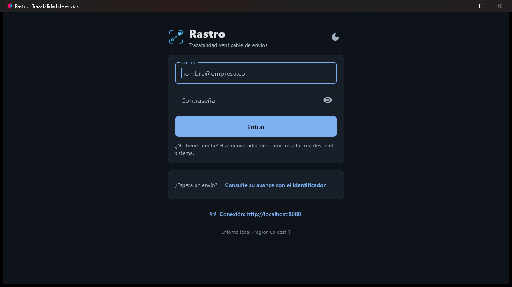

# Módulo `cliente-flet` — Rastro y Cotejo en Flet (escritorio, web y Android)

Ubicación: `cliente-flet/` · Stack: Python 3.11+ con Flet 1.0.5 (modo
declarativo), `flet-map`, `flet-geolocator` y `httpx` · Decisión:
[ADR-016](../../decisiones/adr-016-cliente-flet.md)



## Qué hace

Es una **segunda interfaz**, adicional a las de React, para las dos
aplicaciones del repositorio. Hace lo mismo que `web/` y `cotejo/web/` contra
las mismas APIs, y se ejecuta de tres formas desde el mismo código:

| Forma | Cómo | Para qué |
|---|---|---|
| Escritorio | `python src/rastro.py` | Una ventana de Windows (también macOS y Linux) |
| Web | `flet run --web src/rastro.py` | En el navegador; la lógica corre en el proceso de Python |
| Android | `herramientas/construir.py rastro apk` | El APK del conductor, con GPS en segundo plano |

Cómo ejecutarlo y construirlo paso a paso:
[despliegue del cliente Flet](../../despliegue/cliente-flet.md).

### Rastro

Las mismas 14 pantallas de la web, con las mismas rutas y el mismo control de
acceso por grupo o por permiso:

| Ruta | Pantalla | Archivo |
|---|---|---|
| `/acceso` | Entrar, y **Conexión** para fijar la dirección de la API en el dispositivo | `paginas/acceso.py` |
| `/panel` | Tablero de la empresa, acotado al conductor o, para el auditor, con la verificación de la cadena | `paginas/panel.py` |
| `/envios` | Órdenes: búsqueda, filtros, estado exacto, selección múltiple con barra fija y exportación CSV | `paginas/envios.py` |
| `/envios/nuevo` | Registro individual (con tienda que propone el origen) y **en lote desde CSV** | `paginas/envio_nuevo.py` |
| `/envios/guias` | Vista previa de las guías con código de barras y **PDF de 100 × 150 mm** | `paginas/guias.py` |
| `/envios/<id>` | Histórico, asignación, evidencia en tres pasos y punto de control | `paginas/envio_detalle.py` |
| `/entregas` | Selección de guías y **modo ruta** con transmisión de la ubicación | `paginas/entregas.py` |
| `/seguimiento` | Mapa en vivo de los conductores, recorrido y paradas | `paginas/seguimiento.py` |
| `/operaciones`, `/operaciones/estados` | Módulos de la organización y catálogo de estados | `paginas/operaciones.py` |
| `/maestros/<recurso>` | Tiendas, clientes y transportistas (una sola pantalla para los tres) | `paginas/maestros.py` |
| `/administracion`, `/administracion/roles` | Cuentas, empresa, contraseña y roles configurables | `paginas/administracion.py`, `paginas/roles.py` |
| `/bitacora` | Bitácora y verificación de la cadena, con la vista de eslabones | `paginas/bitacora.py` |
| `/rastreo?envio=<id>` | Consulta pública, sin cuenta, con la posición del vehículo en reparto | `paginas/rastreo.py` |

### Cotejo

La consola del auditor, en `cotejo_app/`: **revisión** (ejecutar el catálogo,
veredicto, controles uno por uno, hallazgos, papel de trabajo con sus dos
huellas, verificación del almacén, informe que se puede guardar),
**catálogo**, **repetir** (comparación de dos ejecuciones) y **diccionario**.
En la web son pestañas; aquí son rutas, para que el botón «atrás» del teléfono
vuelva a la anterior. Entra solo el grupo `auditor`, con la identidad de
Rastro, y en AWS espera la ejecución encargada (`202` + sondeo, ADR-015).

## Estructura

```
cliente-flet/
├── pyproject.toml          dependencias fijadas y permisos de Android
├── src/
│   ├── rastro.py, cotejo.py   entradas de cada aplicación
│   ├── comun/
│   │   ├── configuracion.py   configuración en ejecución (REQ-09)
│   │   ├── http.py            peticiones y errores tipados (ErrorApi)
│   │   ├── datos.py           consultas con caché, refresco e invalidación; formularios
│   │   ├── diseno.py, fichas.py   tema, puntos de corte y colores generados de design/
│   │   ├── ui.py              tarjeta, aviso, métrica, botón, campo, diálogo…
│   │   ├── marca.py           logotipos dibujados con el lienzo de Flet
│   │   └── formato.py         fechas y antigüedad en español de Colombia
│   ├── rastro_app/
│   │   ├── api.py             cliente de la API con renovación de sesión única
│   │   ├── aplicacion.py      raíz: tema, sesión, rutas, botón atrás
│   │   ├── contexto.py        Aplicacion, EstadoSesion, mensajes de error, iconos
│   │   ├── estructura.py      armazón y navegación salida de la base de datos
│   │   ├── proteccion.py      RutaProtegida, ExigeGrupo, ExigePermiso
│   │   ├── consultas.py       claves de caché y consultas compartidas
│   │   ├── ubicacion.py       GPS: lecturas sueltas y Transmisor del modo ruta
│   │   ├── mapa.py            mapa con flet-map y encuadre por Mercator
│   │   ├── evidencia.py       foto y carga en tres pasos
│   │   ├── codigo_barras.py   Code 128B
│   │   ├── guias_pdf.py       PDF de guías sin dependencias
│   │   ├── lote_csv.py        lectura del lote con el módulo csv
│   │   └── paginas/
│   ├── cotejo_app/            api, aplicación, armazón, piezas y 5 pantallas
│   └── assets/
│       ├── configuracion-rastro.json, configuracion-cotejo.json   (las escribe 60-sitios.sh)
│       ├── fuentes/RobotoMono.ttf (OFL)
│       └── iconos/rastro.png, cotejo.png
├── herramientas/
│   ├── generar_fichas.py   design/*.css → src/comun/fichas.py
│   ├── generar_iconos.py   iconos de los paquetes (requiere Pillow)
│   └── construir.py        prepara build/<app>/ y llama a flet build
└── tests/                  44 pruebas de la lógica que no depende de la pantalla
```

## Dependencias y relación con otros módulos

- **Servicios de Rastro** (`services/*`, vía la puerta de enlace o API
  Gateway): los mismos contratos que la web. No se añadió ni cambió ningún
  punto de la API.
- **Cotejo API** (`cotejo/api`): igual que `cotejo/web`.
- **Sistema de diseño** (`design/`): los colores salen de `tokens.css` y de los
  `identidad.css` por `generar_fichas.py`; `tests/test_fichas.py` falla si se
  desincronizan.
- **Despliegue** (`deploy/aws/60-sitios.sh`): copia los `configuracion.json` de
  la web a `src/assets/`.
- Bibliotecas: `flet` 1.0.5, `flet-map` (flutter_map, teselas de
  OpenStreetMap), `flet-geolocator` (geolocator) y `httpx`. Versiones exactas en
  `pyproject.toml`.

## Decisiones y alternativas descartadas

Las de fondo están en el [ADR-016](../../decisiones/adr-016-cliente-flet.md).
Las de la interfaz, aquí:

**Cada pantalla tiene su par web con el mismo nombre.** `Envios`, `EnvioDetalle`,
`PanelPuntoDeControl`… y los mismos comentarios sobre por qué. Leer una junto a
la otra es la forma más barata de mantener dos interfaces.

**Las acciones salen del servidor.** Como en la web, el detalle pregunta
`/transiciones` y la navegación sale de `/catalogos/modulos`; ninguna lista de
estados ni de módulos está escrita aquí.

**Una sesión por página, nada en el módulo.** En el modo web varias pestañas
comparten el proceso de Python; `ClienteRastro`, el almacén de consultas y el
GPS viven en el objeto `Aplicacion` de cada página.

**Los manejadores leen `formulario.actual`, no el estado del último dibujo.**
Si se pulsa Enter justo después de escribir, el evento llega antes de que la
pantalla se vuelva a dibujar con la última tecla, y el formulario se enviaba
con el valor anterior. `use_formulario` guarda los valores en una referencia
que se actualiza en cada pulsación.

**La barra de selección va fija al pie del armazón.** Marcar veinte órdenes e
imprimir sus guías no puede exigir bajar al final de la lista. La pantalla
describe la barra (`BarraFija`) y el armazón la dibuja fuera del
desplazamiento.

**Guías en PDF, no impresión.** Una aplicación instalada no tiene `@media
print`. Se descartó una biblioteca de composición: el PDF son rectángulos y
texto en las fuentes estándar, unas 200 líneas propias y probadas.

**La foto se recomprime al 75 %.** Es la evidencia de una entrega, no una
fotografía para imprimir, y el mensajero paga los datos.

**Mapa encuadrado con Mercator propio.** El encuadre automático de
`flutter_map` dejaba el mapa sin teselas en el cliente de Flet; se calcula el
centro y el zoom con la misma proyección de las teselas.

**Roboto Mono empaquetada.** En Flutter el nombre de una familia no admite lista
de respaldo como en CSS («Consolas, monospace»), y los identificadores salían
con letra proporcional en la web.

## Comportamiento responsive

Los puntos de corte son los del proyecto —sm 640, md 768, lg 1024, xl 1280—,
puestos en cada `ResponsiveRow` (`diseno.PUNTOS_DE_CORTE`) en lugar de los de
Flet (576, 768, 992, 1200).

| Ancho | Armazón | Contenido |
|---|---|---|
| < 1024 px | Barra superior con logotipo, tema y botón de menú; el menú se despliega debajo con las entradas, la identidad y «Salir» | Una columna; rejillas de métricas de 2 en 2 (desde 640) o de 1 en 1; diálogos al ancho de la pantalla menos 64 px |
| ≥ 1024 px | Columna lateral de 240 px con la navegación y la identidad | Dos paneles (`DoblePanel`, 7/5), métricas de 4 en fila, mapa junto a la lista |
| ≥ 1280 px | Igual | Contenido con tope de 1 248 px (los 78 rem de la web), centrado |

Comprobado en el navegador a 360 × 780 y a 1280 × 800 (2026-10-26): el menú
plegado se abre y conserva el estado de la pantalla, las paradas del modo ruta
apilan sus botones en varias líneas, el diálogo de entrega cabe entero, el
listado parte el identificador en vez de desbordar y la consulta pública reparte
el progreso en dos filas. Las tablas anchas (bitácora, catálogo de estados,
rechazos del lote) se desplazan dentro de su tarjeta. Los botones miden al
menos 44 px de alto.

## Trampas de Flet 1.0 que este código esquiva

Se encontraron construyéndolo; cada una está comentada donde se evita.

1. `expand=False` explícito no equivale a omitirlo: Flet envuelve igual el
   control y, dentro de una fila con `wrap=True`, rompe el dibujo (cajas
   grises). Se pasa `True if x else None`.
2. Nada con `expand=True` dentro de `ft.Row(wrap=True)`.
3. Un `Container` con `alignment` ocupa todo el ancho disponible.
4. Flet solo espera los manejadores `async def`; una lambda que devuelve una
   corrutina no se ejecuta. `ui.manejador` los envuelve.
5. `ft.use_ref(x)` llama a `x` si es invocable: para guardar una función,
   `ft.use_ref(lambda: funcion)`.
6. Los manejadores de la página asignados en un efecto no llegan al cliente
   hasta un `page.update()`.
7. Cambiar la forma del árbol de un armazón según el estado vuelve a montar la
   pantalla de debajo y pierde su estado: la estructura es fija y solo cambia la
   visibilidad.
8. Un contexto puesto dentro del componente que usa `use_route_outlet` no llega
   a la pantalla hija; los contextos van por encima del enrutador.
9. Los efectos asíncronos largos llevan `cleanup` (aunque sea vacío) para que
   Flet los cancele al desmontar.

## Pruebas

`cliente-flet/tests` (44): código de barras contra la norma, lector del lote,
PDF válido y sin valor declarado, fichas sincronizadas con el CSS, fechas,
encuadre del mapa, renovación de sesión única ante varios 401 simultáneos, las
reglas de la cola de transmisión y, en Cotejo, la espera de la revisión
encargada y el cierre de sesión. Se ejecutan con:

```bash
cliente-flet/.venv/Scripts/python -m pytest cliente-flet/tests
```

Recorrido manual contra la pila local (2026-10-26), en modo web: acceso,
panel de administrador, conductor y auditor, órdenes con selección y guías,
registro de un envío con tienda, asignación, punto de control, operaciones,
seguimiento con recorrido, administración y edición de una cuenta, roles,
tiendas, bitácora con verificación, modo ruta, diálogo de entrega y consulta
pública con enlace directo. Escritorio: la ventana arranca y muestra el acceso.
Cotejo: revisión, papel de trabajo, verificación del almacén, comparación,
catálogo y diccionario.
