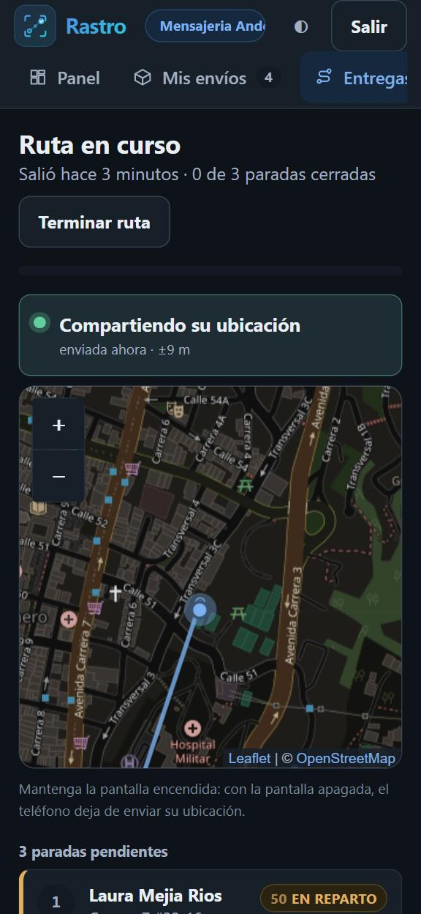
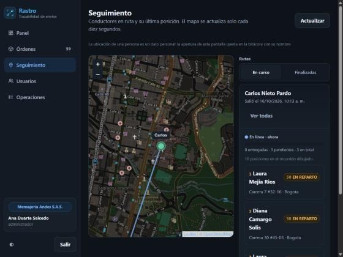
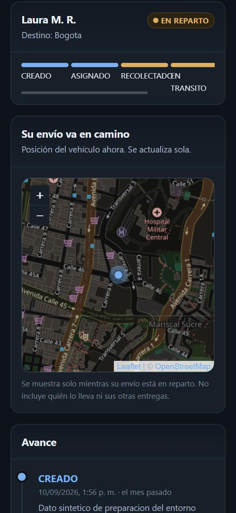

# Módulo · Rutas de entrega y ubicación en vivo

El conductor elige qué guías va a entregar, sale a ruta y, mientras la ruta está
abierta, su teléfono comparte la ubicación. La empresa la ve en el mapa de
**Seguimiento** y el destinatario de cada envío en reparto la ve en la
**consulta pública**.

Decisiones de fondo: [ADR-013](../../decisiones/adr-013-ubicacion-en-vivo-por-sondeo.md)
(sondeo, privacidad, constancia, alcance) y
[ADR-014](../../decisiones/adr-014-mapa-con-leaflet-y-openstreetmap.md) (mapa).
Contratos: [API · Rutas de entrega](../../api/contratos.md#rutas-de-entrega--servicio-tracking).

| Modo ruta (360 px) | Seguimiento (escritorio) | Consulta pública (360 px) |
|---|---|---|
|  |  |  |

---

## Qué hace y cómo se usa

### El conductor — `/entregas`

1. **Elige las guías.** La pantalla muestra las que tiene en su poder
   (recolectadas, en tránsito o en reparto) para marcarlas, y aparte las que le
   asignaron y todavía no recogió, con un botón **Recogido** para marcarlas
   cuando las tenga en el vehículo. Las detenidas por incidencia no pueden salir
   y se avisa.
2. **Sale a ruta.** El navegador pide permiso de ubicación. Sin permiso, la ruta
   no se inicia y se explica cómo darlo; sin señal todavía, sí se inicia y la
   posición llega en cuanto el GPS la consigue. Cada guía pasa a `EN_REPARTO`.
3. **Modo ruta.** Arriba, si su ubicación se está compartiendo, hace cuánto se
   envió y con qué precisión; el mapa con su posición y su recorrido. Debajo, las
   paradas pendientes, cada una con **Llamar**, **Cómo llegar**, **Detalle**,
   **Novedad** y **Entregar**.
   - **Entregar** pide la foto (cámara trasera), la sube cifrada y registra
     `ENTREGADO` con la evidencia y la posición del momento.
   - **Novedad** pide qué pasó y registra `INCIDENCIA`: la parada queda detenida
     y continuarla lo decide la empresa.
4. **Termina la ruta.** Deja de compartir su ubicación. Si quedan paradas
   abiertas, pide confirmación: conservan su estado y las que sigan en reparto
   pueden salir en otra ruta.

Si el navegador se cierra a mitad del recorrido, al volver a **Entregas** la ruta
aparece tal como quedó: su estado vive en el servidor, no en el teléfono.

### La empresa — `/seguimiento`

El mapa muestra la última posición de cada ruta abierta, con el nombre del
conductor y un color por la señal: verde y latiendo si reportó en el último
minuto, ámbar si hace menos de cinco, gris si más. Se actualiza solo cada diez
segundos. Al elegir una ruta se dibuja su recorrido y se listan sus paradas, cada
una enlazada a su envío. **Finalizadas** muestra las rutas cerradas con su
recorrido (se conserva treinta días).

### El destinatario — `/rastreo`

Mientras su envío está en reparto dentro de una ruta abierta, la consulta
pública muestra **Su envío va en camino** con la posición del vehículo y su
antigüedad. Sin nombre del conductor ni otras entregas. Al entregarse el envío,
o al cerrarse la ruta, deja de mostrarse.

## Permisos

| Operación | Qué permite | De fábrica |
|---|---|---|
| `ruta:operar` | Salir a ruta con sus guías, reportar su posición, terminar su ruta, leer la suya | Conductor (y administrador) |
| `ruta:seguir` | Ver las rutas de la empresa y sus recorridos | Administrador, coordinador, despachador |

- `ruta:operar` está restringida a lo propio: solo envíos asignados a quien
  conduce, solo su ruta. Ver toda la operación no autoriza a reportar la
  posición de otro.
- El auditor no tiene ninguna de las dos (ADR-013 § 4).
- Las empresas ya aprovisionadas reciben las operaciones nuevas en sus roles de
  fábrica sin editar nada (`catalogo_conocido`); si la empresa quita una, sigue
  quitada. Ver [roles y permisos](../roles-y-permisos/README.md).

## Piezas

| Pieza | Dónde | Qué decide |
|---|---|---|
| Reglas de dominio | `libs/rastro_core/rutas.py` | Qué estados son aptos, el camino a reparto, la hora creíble de una posición, la señal, lo que ve el público |
| Almacenamiento | `libs/rastro_core/repository.py`, `claves.py` | Ruta, posiciones y testigo de ruta activa en la tabla de envíos |
| Testigo de consulta | `libs/rastro_core/security.py` | Cuándo una lectura ya consta en la bitácora |
| Endpoints de ruta | `services/tracking/main.py` | Inicio, lectura, posiciones, cierre; copia el estado de cada entrega a su parada |
| Endpoint público | `services/public/main.py` | `GET /publico/envios/{id}/ubicacion` |
| Transmisión GPS | `web/src/api/transmision.ts` | Cada cuánto se envía, cola sin señal, pantalla encendida |
| Mapa | `web/src/componentes/Mapa.tsx` | Envoltura de Leaflet, carga diferida |
| Pantallas | `web/src/paginas/Entregas.tsx`, `Seguimiento.tsx`, `Rastreo.tsx` | Selección, modo ruta, seguimiento, vista pública |
| Navegación | `seed/modulos.json` | Módulos `entregas` y `seguimiento` |

## Dependencias y relación con otros módulos

- **Servicio de rastreo** ([README](../servicio-rastreo/README.md)): aloja las
  rutas. Al iniciar una, mueve cada envío por la máquina de estados; al
  registrar un punto de control de un envío en ruta, actualiza su parada.
- **Servicio de evidencias** ([README](../servicio-evidencias/README.md)): la
  entrega desde el modo ruta usa el mismo enlace prefirmado y la misma
  confirmación que la pantalla de detalle.
- **Consulta pública** ([README](../servicio-consulta-publica/README.md)):
  nueva ruta de ubicación, separada de la del histórico.
- **Bitácora** ([README](../servicio-bitacora/README.md)): inicio, cierre,
  consultas de ubicación (una por pantalla cada cinco minutos) y rechazos.
- **Roles y permisos** ([README](../roles-y-permisos/README.md)): dos
  operaciones nuevas en un área propia.
- **Sistema de diseño** ([README](../sistema-de-diseno/README.md)): estilos del
  mapa, de la señal, de las paradas e iconos `ruta` y `ubicacion`.
- **Externas:** Leaflet 1.9.4 (npm) y las teselas de OpenStreetMap.

## Decisiones y alternativas descartadas

| Decisión | Alternativa descartada | Por qué |
|---|---|---|
| Sondeo cada 10–20 s | WebSocket, IoT Core, AppSync, Location Service | Piezas nuevas en un laboratorio que niega servicios sin aviso, para ganar segundos (ADR-013 § 1) |
| Recorrer el flujo principal al salir | Atajo `RECOLECTADO → EN_REPARTO` | Es el control C-07 de Cotejo (ADR-013 § 2) |
| Todo o nada al iniciar | Crear lo que se pueda, como el lote | La selección es la carga del vehículo; una ruta a medias engaña al destinatario |
| Solo guías en poder del conductor | Incluir las asignadas sin recoger | No están en el vehículo; se ofrece marcarlas como recogidas |
| Una ruta abierta por conductor, con testigo condicional | Buscar la ruta abierta en el índice | Un doble toque abriría dos; el testigo se escribe con condición de no existencia |
| Rutas en la tabla de envíos, partición de índice propia | Tabla nueva | Es operación y crece igual que los eventos; sin tabla nueva no hay etapa de despliegue nueva. Su partición `ORG#<org>#RUTAS` no aparece en el listado de envíos |
| Actualizar la ruta por atributos | Reescribir el elemento | Posiciones, entregas y cierre llegan a la vez: con reescrituras, la última borraba a las otras |
| Testigo firmado para la constancia | Registrar cada refresco / no registrar lecturas | 360 eslabones por hora frente a no saber quién miró (ADR-013 § 5) |
| Posición pública redondeada y con antigüedad máxima | La posición exacta mientras haya ruta | Minimización: lo justo para ver acercarse el paquete |
| Endpoint público aparte | Añadir la ubicación al histórico público | No cambiar lo que esa vista promete no mostrar |
| «Cómo llegar» abre el mapa del conductor | Geocodificar y trazar la ruta | Fuera de alcance (ADR-013) |
| Estados aptos servidos por `/rutas/activa` | Lista escrita en la pantalla | Una sola fuente para la regla |

## Comportamiento responsive

Breakpoints del proyecto: `sm` 640, `md` 768, `lg` 1024, `xl` 1280.

| Ancho | Entregas · selección | Modo ruta | Seguimiento | Consulta pública |
|---|---|---|---|---|
| < 640 | Lista a una columna; barra de selección fija abajo | Señal, mapa (`clamp(16rem, 42vh, 30rem)`) y paradas apiladas. Botones de cada parada en rejilla de dos columnas; **Entregar** a todo el ancho | Mapa arriba, lista debajo | Mapa `clamp(14rem, 38vh, 24rem)` |
| ≥ 640 | Igual | Botones de parada en rejilla automática (`minmax(7rem, 1fr)`) | Igual | Igual |
| ≥ 1024 | Igual | Dos columnas: mapa fijo (`sticky`) a la izquierda, paradas a la derecha | Dos columnas 1.6 : 1; mapa fijo de `clamp(24rem, 100dvh − 14rem, 44rem)` | Igual |

Comprobado en navegador real, con datos de la pila local:

- **360 px**: sin desplazamiento horizontal del `body` en Entregas, modo ruta y
  consulta pública (`scrollWidth` = 360); ningún botón de parada desborda.
- **768 y 1280 px**: sin desplazamiento horizontal en Seguimiento ni Entregas.
- **Áreas táctiles**: botones de parada de 44 px de alto; controles de zoom del
  mapa 44 × 44 (los de Leaflet miden 30 y se corrigieron).
- Las ventanas de entrega y novedad se abren como hoja inferior en móvil.
- Textos largos (direcciones, nombres) cortan con `overflow-wrap: anywhere`.

## Limitaciones conocidas

- **Pantalla apagada = sin posición.** Un sitio web no recibe el GPS en segundo
  plano. El modo ruta pide mantener la pantalla encendida (Wake Lock) y, si el
  navegador no lo permite, lo avisa.
- **Solo en conexión segura.** El navegador entrega el GPS a `https` o
  `localhost`. Probar desde un teléfono contra `http://<ip-del-equipo>` no
  funciona; en AWS el sitio va por HTTPS ([ADR-012](../../decisiones/adr-012-sitio-https-por-api-gateway.md)).
- **Cola sin señal en memoria.** Hasta una hora de posiciones se guarda mientras
  no hay conexión; si se recarga la página en ese lapso, se pierden.
- **Retraso de 10 a 25 s** entre el movimiento y el punto en el mapa.
- **La retención por TTL** solo existe en AWS; DynamoDB Local no borra.
